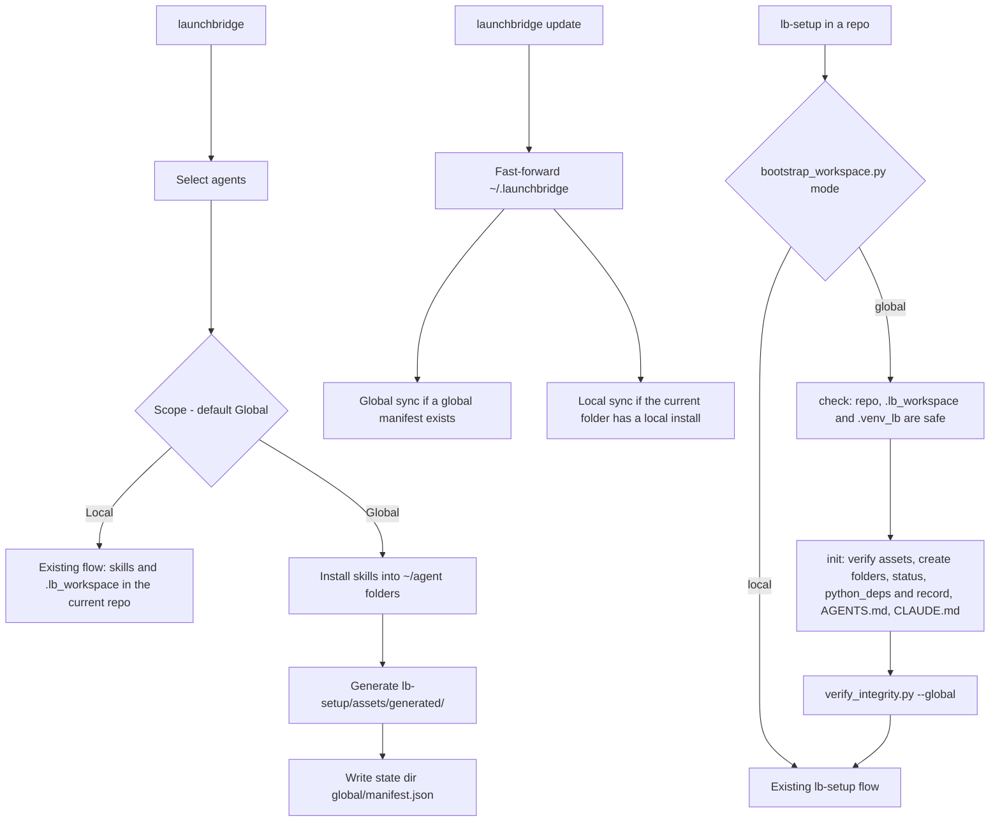

# Implementation Plan: Global Skill Install

## Problem statement

LaunchBridge skills can only be installed into one repo at a time. The installer copies or symlinks them into `<repo>/.<agent>/skills` and writes `.lb_workspace/` and its records into that repo. Users who want LaunchBridge in every project have to run the installer in each repo. This change adds a global install that puts the skills in each agent's user-level folder. lb-setup then creates `.lb_workspace/` and `.venv_lb` in a repo the first time it runs there, after checking that this is safe.

## Requirements

- **R1.** Local and global installs can coexist. If one repo ends up with both, the user sorts it out; LaunchBridge only prints a warning.
- **R2.** The CLI keeps the skill selection. A scope prompt comes right after "Select the agents to install skills for:" and defaults to **Global**.
- **R3.** Local installs work exactly as they do today.
- **R4.** A global install writes nothing into the folder you run it from. lb-setup creates `.lb_workspace/` and `.venv_lb` in the target repo, with safety checks first.
- **R5.** The installer generates the Python dependency files (`pyproject.toml`, `constraints.txt`) and the other files lb-setup needs into the global lb-setup folder.
- **R6.** A global record holds the installed version, skills and digests. `verify_integrity.py` checks the installed global skills against it.
- **R7.** `launchbridge update` updates `~/.launchbridge` and syncs the global install: changed skills, new files in a skill, and regenerated files. Each repo picks up the changes the next time lb-setup runs there.
- **R8.** In global mode, lb-setup keeps `lb_agents_reference.md` in the repo, creates `AGENTS.md` if it's missing, tailors it to the installed skills, and makes sure `CLAUDE.md` contains `@AGENTS.md`.
- **R9.** Every agent the CLI offers today gets global support, each at its documented user-level folder.
- **R10.** The flags `--skills`, `--agent`, `--method` and `--yes` stay. A new `--scope global|local` defaults to `global`.
- **R11.** Shared `~/.agents/skills`: the first selected agent in `AGENTS` order gets its ai-skills copy written there, and the installer warns about it.
- **R12.** Global install works on Windows.

## Background

**Installer.** `main()` in `install_script/index.js` hardcodes `const scope = 'local'`. `getTargetPath(agent, 'global')` in `install_script/lib/pathValidator.js` already maps to `~/<skillsDir>`, but nothing calls it. Today the installer writes these into the repo:

- skills;
- `.lb_workspace/` folders and `.project_artifacts/`;
- `setup_status.md`;
- `config/python_deps/` (scoped `pyproject.toml` and `constraints.txt`), with digests in `~/.config/launchbridge/repos/<key>/python_deps.json`;
- `version_manifest.json` (it also records `install_source.json` in the state directory);
- `lb_agents_reference.md`, and `AGENTS.md` or `AGENTS_LB.md`;
- `CLAUDE.md`.

Every safety check (`checkSkillsDirectory`, `checkWorkspace`) treats the repo as the root.

**lb-setup.** lb-setup depends on what the installer writes:

- It stops (hard stop 6) when the `python_deps/` digests in the state directory are missing.
- It never adds skill rows to `setup_status.md` itself.
- `verify_integrity.py` looks for skills only under `<repo>/<agent folder>`. With global skills it finds none and exits 1.

**What already works from anywhere:**

- The MCP entries. They point at the sealed guard copy in the state directory and the launcher staged in the repo, not at the skills.
- The state-directory key, which depends only on the repo path.
- Scripts that load their sibling scripts relative to their own folder.

**Skill precedence when both copies exist.** In Claude Code a personal skill wins over a project skill with the same name ([docs](https://code.claude.com/docs/en/skills)). In Kiro and Roo Code the project or workspace skill wins ([Kiro](https://kiro.dev/docs/skills/), [Roo](https://roocodeinc.github.io/Roo-Code/features/skills)).

**User-level skill folders:**

| Agent       | Local            | Global                 | Source                                                                                                  |
| ----------- | ---------------- | ---------------------- | ------------------------------------------------------------------------------------------------------- |
| Claude Code | `.claude/skills` | `~/.claude/skills`     | [Claude Code docs](https://code.claude.com/docs/en/skills)                                              |
| Kiro        | `.kiro/skills`   | `~/.kiro/skills`       | [Kiro docs](https://kiro.dev/docs/skills/)                                                              |
| Cline       | `.cline/skills`  | `~/.cline/skills`      | [Cline docs](https://docs.cline.bot/features/skills)                                                    |
| Roo Code    | `.roo/skills`    | `~/.roo/skills`        | [Roo Code docs](https://roocodeinc.github.io/Roo-Code/features/skills)                                  |
| Codex       | `.codex/skills`  | **`~/.agents/skills`** | [Codex docs](https://learn.chatgpt.com/docs/build-skills)                                               |
| pi          | `.agents/skills` | `~/.agents/skills`     | [pi docs](https://raw.githubusercontent.com/badlogic/pi-mono/main/packages/coding-agent/docs/skills.md) |
| Other       | `.agents/skills` | `~/.agents/skills`     | Agent Skills convention                                                                                 |

**Windows:**

- Node's `os.homedir()` and Python's `Path.home()` both return `%USERPROFILE%`. The global folders and the state directory (`%USERPROFILE%\.config\launchbridge`) therefore agree between the installer and the skills. Roo Code documents `%USERPROFILE%\.roo\skills` and `%USERPROFILE%\.agents\skills` explicitly.
- Per-file symlinks (`fs.symlink(..., 'file')` in `install_script/lib/installer.js`) need Developer Mode. The installer already says so and suggests copy.
- Kiro rejects symlinked skill files on every OS ([kirodotdev/Kiro#6401](https://github.com/kirodotdev/Kiro/issues/6401)).
- `inq_run_indexing.sh` has no PowerShell version. That is an existing limitation and doesn't change here.
- CI runs only on `ubuntu-latest`, so Windows path handling is covered by unit tests that use `path.win32` and `PureWindowsPath`, plus a manual check.

**Tests.** JS tests use Vitest under `install_script/__tests__/unit/`. A setup file, `install_script/__tests__/setup/isolateState.js`, points `XDG_CONFIG_HOME` at a temp folder. Python tests use pytest under `tests/unit/`, with a `tests/conftest.py` fixture that isolates `XDG_CONFIG_HOME`. Three test files run the real installer with `--yes`: `tests/unit/test_verify_integrity.py`, `install_script/__tests__/unit/installedTargets.test.js` and `install_script/__tests__/unit/installedContent.test.js`. Nothing in the tests sets `HOME` yet.

## Proposed solution

### Design decisions

- **D1. The mode comes from where lb-setup is installed.** If lb-setup's own folder is inside the repo, it runs the local flow. Otherwise it runs the global flow. A new `bootstrap_workspace.py mode` prints which one applies, and warns once when the repo also has the other kind of install.
- **D2. The global record lives in the state directory.** It is `<state base>/launchbridge/global/`, where the state base follows the existing rule (an absolute `XDG_CONFIG_HOME`, otherwise `~/.config`). The folder has mode 0700 and the files 0600, and they are written atomically. It holds two files:
  - `manifest.json`: `scope`, `version`, `timestamp`, `deliveryMethod`, `agents`, `installMethod`, `gitCommitHash`, `sourcePath`, `skills`, `skillHashes`, `externalSkillHashes`, `externalManifestKeys`, `installedTargets` (relative to home), `generatedAssets`, `pyprojectHash`, `generatedPyprojectHash`, `mcpTemplateHash`, `agentsHash`, `skillRequiresSetup` and `mcpGatedSkills`.
  - `install_source.json`.
- **D3. Generated files go in `<global skills folder>/lb-setup/assets/generated/`.**
  - Contents: `python_deps/pyproject.toml`, `python_deps/constraints.txt`, `setup_status.md` (a template with the global selection's rows, including the `ai-domain-*` rows), `workspace_layout.json` (the folders to create in a repo) and `lb_agents_reference.md`.
  - They are built with the installer's existing functions, so all this logic stays in one place: `buildPyprojectContent`, `buildSetupStatusContent` plus `buildStatusRows`, `WORKSPACE_SUBDIRECTORIES` and `ARTIFACT_STRUCTURE`.
  - They are written as real files: any existing file is removed first, then written with the `wx` flag. A symlink install therefore never writes through a link into the clone.
  - Both content hashers (`install_script/lib/contentHash.js` and `skills/lb-setup/scripts/verify_integrity.py`) skip `assets/generated/` at a skill's root. `verify_integrity.py` then checks that the folder holds exactly the recorded files with the recorded digests.
  - A local install has no reason to have this folder, so finding one there counts as a modification. A test makes sure the source tree never contains it.
- **D4. Safety checks for the global skills folders (`checkGlobalSkillsDirectory`).**
  - The folder must be under `os.homedir()` as written.
  - The installer refuses if the folder's real location is inside the LaunchBridge source.
  - Symlinked parent folders, such as `~/.claude` pointing into a dotfiles repo, are allowed, and the installer prints the real location.
  - A skill folder is replaced or removed only when the global manifest's `installedTargets` lists it. These are the same ownership rules as local installs.
- **D5. Repo checks in global mode (`bootstrap_workspace.py check`), run before anything is created.** On any failure, nothing is written and lb-setup stops with the reasons (hard stop 6).
  - The repo must be an existing absolute folder owned by the current user.
  - It must not be the filesystem root, `$HOME` or a parent of `$HOME`. It must not be inside the LaunchBridge source, the state directory or an agent's global skills folder.
  - The state directory must resolve outside the repo.
  - `.lb_workspace/`, every folder and file the bootstrap writes, `AGENTS.md`, `CLAUDE.md`, `.project_artifacts/` and `.venv_lb` must stay inside the repo and not be reached through a symlink.
  - git must track nothing under `.venv_lb/`, `.lb_workspace/config/` or `.lb_workspace/indexing_and_qa/` except the files in `TRACKED_OK`. This reuses `lb_guard.py`'s checks, loaded as a sibling script.
  - An existing `.venv_lb` is never trusted by this step. The existing `lb_guard.py check` in Step 0b still decides whether it gets rebuilt.
- **D6. Per-repo record.** `repos/<key>/global_setup.json` holds the global manifest's version, skill digests, `generatedAssets` and the dependency, MCP-template and AGENTS hashes as of the last `init`. On the next `init`, any differences reset rows using the same rules as `runPostPullSync` step 5b in `install_script/lib/updater.js`. The record lives outside the repo.
- **D7. Update.** `launchbridge update` fast-forwards the clone as it does now. It then runs `runGlobalSync` when a global manifest exists:
  - It reinstalls changed skills with the recorded method, copy or symlink. Reinstalling symlink installs too gives new files their links.
  - It regenerates the assets, updates the ai-skills and rewrites the manifest.
  - Then, if the current folder has a local install, it runs the existing `runPostPullSync`. The `checkWorkspace` refusal now applies only to that local step.
  - Skills that are new upstream are not added automatically. You re-run `launchbridge` to select them, as with local installs.
- **D8. Shared `~/.agents/skills`.** `copyFor` in `install_script/lib/aiSkills.js` compares agents by their folder for the scope in use, and the first selected agent wins. When Codex, pi or Other share the folder, the installer warns which agent's form the others will see.
- **D9. CLI flags.** `--scope global|local` defaults to `global` in both the prompt and flag runs. The three test files that run the installer pass `--scope local`.
- **D10. Integrity baseline in global mode.** The baseline is the global manifest and nothing else. `--write-baseline` is refused in global mode: the baseline changes only through the installer or `launchbridge update`, and the update preview is the review step. Global mode writes no `skill_digests.json` into the repo.

### Out of scope

These are existing issues or separate changes, noted here so they aren't lost:

- The local Codex path `.codex/skills`, which the current Codex docs don't list.
- User-level MCP files that can hold only one repo's entry (Codex `~/.codex/config.toml` and Cline's settings file).
- Removing `--yes`.
- A PowerShell version of `inq_run_indexing.sh`.
- A Windows CI job (optional addition; see the end of this file).
- Resolving a repo that has both a local and a global install, beyond the warning.

## Execution notes for the implementing agent

- **Key files:**
  - Installer: `install_script/index.js`, `install_script/lib/agentConfig.js`, `pathValidator.js`, `promptManager.js`, `stateDir.js`, `aiSkills.js`, `venvSetup.js`, `setupStatus.js`, `folderSetup.js`, `versionManifest.js`, `contentHash.js`, `updater.js`, `reporter.js`, `orphanCleanup.js`, `installedTargets.js`, `agentsSteering.js`, `claudeMd.js`.
  - lb-setup: `skills/lb-setup/SKILL.md`, `skills/lb-setup/scripts/lb_guard.py`, `verify_integrity.py`, `venv_identity.py`, `check_mcp_paths.py`.
  - Steering: `agent_steering/AGENTS.md`.
- **Test commands, as CI runs them:**
  - JS: `npm test` (Vitest, config at `install_script/vitest.config.js`).
  - Python: `PYTHONPATH=skills/evaluate-predictions/lib/metric-library pytest tests/unit/ -v --tb=short`.
  - Lint: `./run_lint.sh`.
- **Test isolation:** global-mode tests must set `HOME` (and `USERPROFILE` for Windows path cases) to a temp folder, as well as `XDG_CONFIG_HOME`. Node's `os.homedir()` and Python's `Path.home()` read these. Never touch the real `~/.claude`, `~/.kiro` or `~/.config`.
- **Follow the existing patterns:**
  - Use `safePathJoin` and `checkPathInRoot`-style component checks.
  - Write state files with mode 0600 inside a 0700 folder.
  - Use dependency injection instead of module mocks.
  - Python scripts run with `python3 -I` and use only the standard library.
- **Don't use `git stash` to get a test baseline.** Use `git show HEAD:<path>` instead.
- **Don't put threat-model IDs or rationale in code comments.**
- **Changed files and digests:** changing a `SKILL.md` changes that skill's digest, which is expected. Update any test fixtures that pin digests.
- **Work order:** do the tasks in order. Each one ends with its tests passing and its demo working.

## Task breakdown

### Task 1: Skills folder for each agent and scope

- **Objective:** one function returns each agent's skills folder for a given scope. Codex's global folder is `~/.agents/skills`.
- **Guidance:**
  - Add `globalSkillsDir` to `AGENTS` in `agentConfig.js`: `.agents/skills` for Codex, and the same as `skillsDir` for every other agent.
  - Add `getSkillsDir(agent, scope)`, make `getTargetPath(agent, 'global')` use it, and correct its JSDoc.
  - Pass the scope through `copyFor`, `writeAgentFiles` and `computeAiSkillFolderHashes` in `aiSkills.js`, defaulting to `local`.
  - Add `AGENT_GLOBAL_SKILLS_DIRS` to `verify_integrity.py`.
- **Tests:**
  - `agentConfig` and `pathValidator` tests with `HOME` set to a temp folder, including `path.win32` cases.
  - `copyFor` in global scope: Codex and pi share a folder and Codex wins.
  - Extend the JS/Python parity test in `tests/unit/test_verify_integrity.py` so it covers the global table.
- **Demo:** `npm test` shows `getTargetPath('codex','global')` returning `$HOME/.agents/skills`, and every local path unchanged.

### Task 2: Scope prompt, `--scope` flag and global skill install

- **Objective:** `launchbridge` asks for the scope after the agents, with Global as the default. In global mode it installs the skills into the home folders, writes the global manifest and `install_source.json`, and writes nothing into the current folder.
- **Guidance:**
  - Add `promptForScope()` to `promptManager.js`. The labels show example paths.
  - Handle `--scope` in `parseCLIFlags` and `validateAndResolveFlags`, and replace `const scope = 'local'`.
  - In global mode, `main()` skips these repo steps: `checkWorkspace`, `validateTargetDirectory`, `readManifest(cwd)`, `runFolderSetup`, the status write, `runVenvSetup`, `copyAgentsSteering`, `copyClaudeMd` and the repo manifest.
  - Add `checkGlobalSkillsDirectory` (D4) to `pathValidator.js`. Add `globalStateDir()`, `writeGlobalState()` and `readGlobalManifest()` to `stateDir.js`.
  - Make the reporter print the scope and the real target paths.
  - Pass `--scope local` in the three test files that run the installer.
- **Tests:**
  - Unit tests for the prompt default and the flag.
  - A spawn test with temp `HOME` and `XDG_CONFIG_HOME`, run from an empty temp folder with `--scope global --agent claude,kiro --skills all --method copy --yes`. It checks that the skills are under `HOME`, the manifest is written and the folder is still empty.
  - A refusal test where `~/.claude/skills` resolves inside the source.
  - All local tests still pass.
- **Demo:** from any folder, run `launchbridge`, pick Claude Code and then Global. `~/.claude/skills/*` is filled and the current folder is unchanged.

### Task 3: Re-running a global install

- **Objective:** re-runs work the same way as local ones: "up to date", incremental installs, a change of method, orphaned skills and folders LaunchBridge didn't install.
- **Guidance:**
  - Run `determineLifecycle` against the global manifest and ignore its status-reset outputs, which belong to repos.
  - `wasInstalledByLaunchBridge` and `cleanupOrphanSkills` use `installedTargets` relative to home.
  - Shared folders are deduplicated, and the D8 warning is added.
- **Tests:**
  - A second identical run changes nothing.
  - A deselected skill is offered for removal, and `--yes` never removes it.
  - A foreign `~/.claude/skills/ai-plan` is left alone.
  - Switching from copy to symlink reinstalls without prompting.
  - Choosing Codex and pi together prints the warning.
- **Demo:** run `launchbridge` twice. The second run reports up to date. Deselect a skill and you are offered its removal.

### Task 4: Generated assets in the global lb-setup folder

- **Objective:** a global install writes `assets/generated/` (D3) into each agent's lb-setup folder and records the digests.
- **Guidance:**
  - Factor the content builders out of `venvSetup.js`, `setupStatus.js` and `folderSetup.js` so they write to any folder, then add `writeGlobalAssets(lbSetupDir, selection, sourcePath)`.
  - Exclude `assets/generated/` at a skill's root in `contentHash.js` and in `verify_integrity.compute_content_hash`.
  - Store `generatedAssets` in the manifest.
- **Tests:**
  - The generated `pyproject.toml` matches `buildPyprojectContent` for the selection.
  - With symlink installs, the generated files are regular files.
  - Python and JS produce the same hash for a folder that contains `assets/generated/`.
  - The source tree has no `skills/lb-setup/assets/generated`.
- **Demo:** after a global install, `~/.claude/skills/lb-setup/assets/generated/` holds the five files, and the manifest lists their digests.

### Task 5: `verify_integrity.py --global`

- **Objective:** lb-setup can check the installed global skills against the global manifest.
- **Guidance:**
  - Add a `--global` mode that reads `global/manifest.json` and `install_source.json` from the state directory.
  - It checks `~/<globalSkillsDir>/<skill>` for each recorded agent. The stray-link check (`_stray_link`) uses the skills folder as its root, and links must resolve into the recorded source.
  - It checks the generated assets with the exact-file-set rule from D3.
  - In local mode, an `assets/generated/` folder is reported as modified.
  - Refuse `--write-baseline` together with `--global`. Keep the report output and exit codes as they are.
- **Tests (pytest, run against the real installer in global mode with temp `HOME` and `XDG_CONFIG_HOME`):**
  - A clean install passes.
  - An edited `SKILL.md` is reported as MODIFIED.
  - An extra file in `assets/generated/` is MODIFIED.
  - A removed skill is MISSING.
  - A symlink install whose link is retargeted fails.
- **Demo:** `python3 -I ~/.claude/skills/lb-setup/scripts/verify_integrity.py --global <repo>` exits 0, and exits 1 after you edit a skill.

### Task 6: `bootstrap_workspace.py mode` and `check`

- **Objective:** a standard-library Python script reports the install mode and runs the repo safety checks (D1, D5) without writing anything.
- **Guidance:**
  - Add the script at `skills/lb-setup/scripts/bootstrap_workspace.py`. It reuses `lb_guard.py` (`repo_state`, `_git_tracked`, `TRACKED_OK`, `printable`) loaded as a sibling, the way `check_mcp_paths.py` does.
  - Output is JSON on stdout. Exit codes: 0 for OK, 1 for refused, 2 when the check can't run.
- **Tests:**
  - Mode detection with lb-setup inside and outside the repo.
  - Refusals for each of: `$HOME`, `/`, a parent of `$HOME`, inside the source, a symlinked `.lb_workspace`, a symlinked `AGENTS.md`, a tracked `.lb_workspace/config/x`, and a state directory inside the repo.
  - Windows paths with `PureWindowsPath` where the logic is pure.
- **Demo:** `bootstrap_workspace.py check ~` refuses with a reason, and `check <scratch repo>` returns OK.

### Task 7: `bootstrap_workspace.py init`

- **Objective:** create everything a fresh repo needs in global mode.
- **Guidance:** `init` does the following in order:
  1. Runs `check` first.
  2. Verifies `{skill_dir}/assets/generated/` against the manifest. If they don't match, it refuses and tells the user to re-run `launchbridge`.
  3. Creates the folders from `workspace_layout.json`, checking each path component.
  4. Writes `setup_status.md` from the template if it's missing. If it exists, it adds the missing template rows and marks skills outside the selection `not installed`.
  5. Recreates `config/python_deps/` and writes `python_deps.json` in the repo's state directory, in the format `venvSetup.js` uses.
  6. Copies `lb_agents_reference.md` into `.lb_workspace/config/`.
  7. Handles `AGENTS.md` (copy it, or stage `AGENTS_LB.md`) and `CLAUDE.md` (`@AGENTS.md`), following `agentsSteering.js` and `claudeMd.js`. A symlinked `AGENTS.md` or `CLAUDE.md` is never written through.
  8. Writes `global_setup.json` and prints a JSON summary.
  9. Prints the D1 warning when the repo has a local `version_manifest.json`.
- **Tests:**
  - A fresh repo gets the expected tree, and `venv_identity.py deps` then exits 0.
  - An existing `AGENTS.md` leads to `AGENTS_LB.md` being staged.
  - An existing `CLAUDE.md` gets `@AGENTS.md` prepended.
  - A tampered asset is refused.
  - A second `init` with nothing changed modifies nothing.
- **Demo:** on a scratch repo, `init` followed by `venv_identity.py deps` exits 0, and `.lb_workspace/`, `AGENTS.md` and `CLAUDE.md` all exist.

### Task 8: Picking up changes to the global install in each repo

- **Objective:** when `init` runs again after a global change, the affected rows reset (D6).
- **Guidance:** compare `global_setup.json` with the manifest:
  - A skill whose digest changed goes back to `not started`, or to `ready` according to `skillRequiresSetup`.
  - A change to the dependencies sets `venv-setup` to `not started` and rewrites `python_deps/` and its record.
  - A change to the MCP template sets `mcp-setup` to `not started`.
  - A change to the AGENTS reference, or to any skill, sets `agents-md-merge` to `not started` and stages `AGENTS_LB.md` when `AGENTS.md` differs.
  - Skills added to the selection get new rows, and removed ones become `not installed`.
  - The record is then updated.
- **Tests:** one test per kind of reset, using a changed manifest. Rows that are unaffected keep their status.
- **Demo:** reinstall globally with one more skill, run `init` in a repo that was already set up, and only the new row and `agents-md-merge` change.

### Task 9: Wiring global mode into lb-setup's `SKILL.md`

- **Objective:** lb-setup runs the global flow from start to finish.
- **Guidance:**
  - Add a step before Step 0 that finds `{codebase_abs_path}` and runs `mode`. In global mode it then runs `init`, and a non-zero exit is hard stop 6.
  - Update the Status File section: in global mode the bootstrap creates `setup_status.md`.
  - Step 0 item 2: run the `version_manifest.json` check only in local mode.
  - Step 0b: in global mode, the fix for a failed `deps` check is to re-run `launchbridge` (global) and then lb-setup.
  - Step 0c: in global mode, run `verify_integrity.py --global` and never `--write-baseline`. The fix is `launchbridge update` or re-running `launchbridge`.
  - Steps 1 and 1a: note that the bootstrap staged `AGENTS_LB.md`.
  - Step 5: read the global manifest in global mode.
  - Step 6: replace the `{skill_dir}/../../agent_steering/AGENTS.md` fallback with `{skill_dir}/assets/generated/lb_agents_reference.md`.
  - File & Directory Creation Fallback: note that a global `{skill_dir}` is always outside the workspace.
- **Tests:** a pytest that every `bootstrap_workspace.py` and `verify_integrity.py` command named in `SKILL.md` is a real subcommand or flag.
- **Demo:** with a global install for Claude Code, open a fresh repo and say "set up launchbridge". `.lb_workspace/`, a sealed `.venv_lb` and the MCP config are created, and the integrity check passes.

### Task 10: Path wording in the other skills and in `AGENTS.md`

- **Objective:** no skill text assumes the skills folder is inside the repo.
- **Guidance:**
  - `skills/indexing-and-qa/SKILL.md` "Script Path Convention" (lines 140–154): allow this agent's skills folder in the project or in the user's home.
  - The "`<skills folder>` … (for example `.claude/skills`)" sentence in the Python skills (generate-predictions, operational-metrics, testing-framework, evaluate-predictions, config-prompt-registry): add the `~/.claude/skills` example.
  - Update the examples at testing-framework line 68 and config-prompt-registry line 72.
  - ai-workflow Step 0: add the home folders to the list it probes.
  - `agent_steering/AGENTS.md`: describe both scopes in the wording.
  - `lb_guard.py`: change the advice text for global installs, and add a test documenting that global skill folders are outside the repo's import checks by design.
- **Tests:** the existing skill and steering tests, plus the new `lb_guard.py` test.
- **Demo:** from a global install, indexing-and-qa indexes a repo, and ai-workflow finds `~/.claude/skills/ai-create`.

### Task 11: Global sync in `launchbridge update`

- **Objective:** `launchbridge update` keeps the global install current (D7).
- **Guidance:**
  - Add `runGlobalSync(sourcePath, ui)`. It reinstalls changed native skills only where `installedTargets` lists them, for both methods.
  - It regenerates the assets, runs `updateAiSkills` with the scope, writes the manifest atomically and records the install source.
  - In `runUpdateCommand`, run `checkWorkspace` only before the local sync. Print "Repos pick up the changes the next time lb-setup runs there."
- **Tests:**
  - A copy install with a changed skill is reinstalled, and `verify_integrity --global` then passes.
  - A symlink install where a skill gained a file gets the new link.
  - A changed constraints file regenerates the assets.
  - Running from a folder with no local install doesn't fail.
- **Demo:** run `launchbridge update` from any folder, then lb-setup in an existing repo. Only the changed rows reset.

### Task 12: Documentation and the Windows check

- **Objective:** users can choose a scope and understand what each one does.
- **Guidance:**
  - `README.md`, `QUICKSTART_INSTALL.md` and `docs/USER_GUIDE.md`. Document:
    - the scope prompt and the `--scope` flag;
    - what each scope writes;
    - the folder table, including Codex at `~/.agents/skills` and the shared-folder note;
    - which copy runs when both exist (Claude Code prefers personal, Kiro prefers workspace);
    - how update works;
    - Windows: `%USERPROFILE%`, Developer Mode for symlinks, and copy for Kiro.
  - Update the README architecture diagram to show the installer writing to user-level folders and lb-setup bootstrapping the workspace.
  - Add a release note to `version.txt`.
  - Add a manual Windows checklist covering a copy install, a symlink install with Developer Mode, and `bootstrap_workspace.py` run with `python`.
- **Tests:** `./run_lint.sh` passes.
- **Demo:** following only the README, a new user installs globally and sets up a repo.

## Optional addition

A `windows-latest` job in `.github/workflows/ci.yml` for the JS and Python tests, which would cover R12 in CI. It is not part of the tasks above unless approved.
