<!-- Copyright Amazon.com, Inc. or its affiliates. All Rights Reserved. -->
<!-- SPDX-License-Identifier: MIT-0 -->

# LaunchBridge

> **Sample code for proof-of-concept and non-production use.** LaunchBridge, its
> IAM policy template, and the code and configuration its skills write into your
> project are provided as starting points. Before using any of it in production,
> review it with your security, legal and compliance teams and adapt it to your
> organization's requirements.

LaunchBridge is a suite of AI agent skills installed into any codebase to give your coding agent deep, persistent understanding of that project. The core idea: instead of re-explaining your codebase every session, LaunchBridge indexes it once and updates as needed, so your agent always has context, coding guardrails, and tooling ready to go.

It ships as a CLI installer (`launchbridge`) that copies or symlinks the skills for Kiro, Claude Code, or any compatible agent: globally, into each agent's user-level skills folder so every project can use them (the default), or locally, into one target repo. Once a project is set up, the skills work together across a full development lifecycle:

- **Understand** — `indexing-and-qa` indexes source files and project documents (PDFs, decks, meeting notes) into queryable summaries via an MCP server
- **Govern** — `code-guardrails` generates project context, scope, and best-practice files that keep the agent aligned with your architecture
- **Track** — `config-prompt-registry` maintains a single source of truth for every model ID, config value, and prompt template
- **Test** — `testing-framework` discovers, creates, and runs tests
- **Evaluate** — `data-wrangler` → `generate-predictions` → `evaluate-predictions` forms a pipeline to run the repo's model and score its output against ground truth
- **Measure** — `operational-metrics` instruments GenAI calls and produces cost/latency reports with scaling projections
- **Feature Recommendation** — `feature-recommendations` can recommend future development areas to expand features or add new ones and get a feel for production readiness

## Getting Started

### Installing Skills

The skill installer CLI helps you install LaunchBridge skills into your target repositories.

**Quick install.** Install the `launchbridge` command once:

```bash
npm install -g github:aws-samples/sample-launchbridge
```

Then run it once, from any folder, and keep the default scope, **Global**:

```bash
launchbridge
```

The skills are now available to your agent in every project. Open your agent in a repository and run `lb-setup`, which prepares that repository the first time. To install into one repository only, run `launchbridge` in it and choose **Local** (see [Global or local](#global-or-local)).

This needs Node.js 22.13 or later, npm and git (see [Prerequisites](#prerequisites)). [Option A](#option-a-install-the-command-with-npm-recommended) below explains what it sets up; [Option B](#option-b-clone-and-link-development-and-signed-releases) covers installing from a clone.

For active development, use 'symlink' so edits to skills in this repo are immediately available in your target project without reinstalling. A symlink install makes each skill folder a link to its folder in the LaunchBridge clone (a junction on Windows); an AI skill that an agent gets its own `SKILL.md` for is copied for that agent instead.

> **Note:** Codex skips a skill whose `SKILL.md` alone is a link but loads a linked skill folder ([openai/codex#15844](https://github.com/openai/codex/issues/15844)). Older Kiro IDE and Cline releases don't load skill folders that are links ([kirodotdev/Kiro#6401](https://github.com/kirodotdev/Kiro/issues/6401), [cline/cline#11113](https://github.com/cline/cline/pull/11113)): the installer warns when a symlink install is for Kiro or Cline, and if the skills don't show up there, install again with 'copy' (`--method copy`).

#### Prerequisites

- Python version 3.12 or higher
- [Node.js](https://nodejs.org/) (v22.13 or higher recommended)
- npm (comes with Node.js)
- git
- AWS Profile with Credentials

#### AWS Credentials

AWS CLI v2 with at least one profile configured is required — see [AWS CLI v2 installation guide](https://docs.aws.amazon.com/cli/latest/userguide/getting-started-install.html).

**Setting up an AWS profile:** use temporary credentials from AWS IAM Identity Center where you can. Configure the profile once, then sign in when the session expires:

```bash
aws configure sso --profile my-profile
aws sso login --profile my-profile
```

If you must use long-term IAM user access keys, `aws configure --profile my-profile` stores them in `~/.aws/credentials`; rotate them regularly.

**Use a profile scoped to Bedrock inference.** The core skills need only `bedrock:InvokeModel` and `bedrock:InvokeModelWithResponseStream` (plus `bedrock:ApplyGuardrail` if you enable the optional Q&A guardrail) and create no AWS resources; the optional features in the table below need more, and video transcription writes S3 objects and Transcribe jobs. Anything broader is inherited by any prompt injection through indexed content, or any compromised package in `.venv_lb`. A least-privilege policy to start from is in [`skills/lb-setup/templates/bedrock-least-privilege-policy.json`](skills/lb-setup/templates/bedrock-least-privilege-policy.json) (replace `ACCOUNT_ID`, trim models and regions to the ones you use). lb-setup checks the profile's effective permissions and asks before indexing if it finds a broader one.

Optional features need more, only when you turn them on. Scope each to its resources:

| Feature                                                        | Actions                                                                                                                                                                                                                                                      |
| -------------------------------------------------------------- | ------------------------------------------------------------------------------------------------------------------------------------------------------------------------------------------------------------------------------------------------------------ |
| Textract OCR for artifacts (`artifact_ocr_provider: textract`) | `textract:DetectDocumentText`                                                                                                                                                                                                                                |
| Video transcription (`artifact_transcription_enabled`)         | `transcribe:StartTranscriptionJob`, `transcribe:GetTranscriptionJob`, `transcribe:DeleteTranscriptionJob`; on the transcription bucket, `s3:GetBucketLocation`, and on its `iris-transcribe-temp/` prefix, `s3:PutObject`, `s3:GetObject`, `s3:DeleteObject` |
| Synthetic audio in data-wrangler (Amazon Polly)                | `polly:SynthesizeSpeech`, `polly:DescribeVoices`                                                                                                                                                                                                             |

For example, the S3 part of transcription can be limited to `arn:aws:s3:::<bucket>` for `s3:GetBucketLocation` and `arn:aws:s3:::<bucket>/iris-transcribe-temp/*` for the object actions.

#### Option A: install the command with npm (recommended)

Install the `launchbridge` command once:

```bash
npm install -g github:aws-samples/sample-launchbridge
```

Then run it, from any folder for a global install, or in the target repository for a local one:

```bash
launchbridge
```

The first `launchbridge` run clones `main`, with its submodules, into `~/.launchbridge` and installs its npm packages there. Every run installs from that one clone, so a symlink install links the installed skills to `~/.launchbridge`. `launchbridge update` updates the clone once, and brings a global install up to date with it; each repository picks up the changes the next time lb-setup runs there. Run it in a repository with a local install to update that install too.

`~/.launchbridge` must hold only the clone. If it exists but isn't a clone of this repository, `launchbridge` stops and changes nothing.

Notes:

- **After switching Node versions** (nvm and similar tools), the command isn't found until you run `npm install -g github:aws-samples/sample-launchbridge` again under the new version. Your skill links point at `~/.launchbridge`, so they aren't affected.
- **Permission errors from `npm install -g`** come from a system-wide Node install; follow npm's guide to [resolving EACCES permissions errors](https://docs.npmjs.com/resolving-eacces-permissions-errors-when-installing-packages-globally) rather than using `sudo`.
- **No signature check.** This path tracks `main` and doesn't verify release signatures; use Option B and [Verifying a release](#verifying-a-release) when that matters to you.

#### Option B: clone and link (development and signed releases)

Clone the repository, then run the setup script once. It initializes the submodules, installs the CLI dependencies from the lockfile, and links the `launchbridge` command globally:

```bash
git clone https://github.com/aws-samples/sample-launchbridge.git
cd sample-launchbridge
npm run setup
```

Next, run `launchbridge` to install the skills: from any folder for a global install, or in your target repository for a local one:

```bash
launchbridge
```

#### What the installer does

The installer will:

1. Prompt you to select which agents to install for (Kiro, Claude Code, etc.)
2. Prompt you to choose the scope: **Global** (default) or **Local** (the default in a folder that already has a local install)
3. Prompt you to choose the installation method (symlink or copy)
4. Install the skills you select into the agents' skills folders
5. For a global install: record the install in `~/.config/launchbridge/global/` (under `$XDG_CONFIG_HOME` when that is an absolute path), and generate the files lb-setup prepares each repository from beside the record, in `generated/`. No repository is changed.
6. For a local install: create the `.lb_workspace` folder structure in the repository and generate `.lb_workspace/config/python_deps/pyproject.toml` with the correct dependencies

> **Note:** AWS credentials and profile selection are handled by `lb-setup` (the agent skill), not the CLI installer. Run `lb-setup` in your agent after installation to configure your AWS profile and complete setup. For a global install, run it in each repository you use LaunchBridge in; the first run creates `.lb_workspace/` and `.venv_lb` there.

#### Global or local

|                                 | Global (default)                                                                                                                                                | Local                                                                                           |
| ------------------------------- | --------------------------------------------------------------------------------------------------------------------------------------------------------------- | ----------------------------------------------------------------------------------------------- |
| Skills                          | Each agent's user-level folder: `~/.claude/skills`, `~/.kiro/skills`, `~/.cline/skills`, `~/.roo/skills`, and `~/.agents/skills` for Codex, Pi and other agents | The repository's agent folders: `.claude/skills`, `.kiro/skills`, … (`.codex/skills` for Codex) |
| `.lb_workspace/` and `.venv_lb` | Created by `lb-setup` in each repository, the first time it runs there, after checking the folder is safe to prepare                                            | `.lb_workspace/` created by the installer; `.venv_lb` by `lb-setup`                             |
| Record of the install           | `~/.config/launchbridge/global/`                                                                                                                                | `.lb_workspace/config/version_manifest.json` and `skill_digests.json`                           |
| Run `launchbridge` from         | Any folder                                                                                                                                                      | The repository                                                                                  |

A local install keeps a repository self-contained (for example a delivered codebase), and a global install serves every project. Keep one of them for each repository: where a repository has a local install and you also have a global one, Claude Code and Cline run the global skills and Kiro and Roo Code the local ones, and lb-setup from the global install refuses to prepare that repository. So a global install for Claude Code or Cline doesn't combine with a local install you use from those agents: remove one of the two ([how](docs/USER_GUIDE.md#global-or-local-install)), or set the repository up from Kiro or Roo Code when its local install is for them. On Windows the global folders are under `%USERPROFILE%`. Older Kiro IDE and Cline releases don't load linked skill folders, so use copy for them if the skills don't show up (see the note above). The [User Guide](docs/USER_GUIDE.md#global-or-local-install) has the details.

#### Updating LaunchBridge

To pull the latest changes and sync them in one command (this updates `~/.launchbridge` if you installed with npm, or your own clone), run it from any folder for a global install, or from your target project for a local one:

```bash
launchbridge update
```

This fetches the current branch and shows what would change — incoming commits, changed `SKILL.md` instructions, installer files and submodule pointers — and applies it only after you confirm (default **no**; for scripted use, review the preview and run `launchbridge update --apply <commit>`). For a global install, it then copies changed skills again (a symlink install's links already show them), restores missing ones, regenerates the files lb-setup prepares repositories from, and updates the global record; each repository picks up the changes the next time lb-setup runs there. It leaves as it is an edited copy (whether or not the skill changed), a real folder where a link should be, and an agent's skills folder that is gone as a whole. It keeps a skill, or the generated files, at the recorded version while the clone has changes that are not committed to it or to the files they are built from, and takes nothing new from the clone when git can't tell. It says which, and how to fix each. It updates a global install only from the clone that install came from. For a local install in the current folder, it re-copies changed skills (for copy installs), resets their setup status, and regenerates dependencies if needed. It exits 1 when it could not bring every install up to date. Then open your agent and say "update launchbridge" to re-run lb-setup for the changed skills; for a local install, lb-setup holds back changed skills until you have reviewed them and refreshed the digest baseline.

**On a release tag.** `launchbridge update` follows the branch your clone is on. If you checked out a release tag, the clone has no branch to follow, so the command stops and shows these steps instead. To move to a newer release, verify and check out its tag, then run the installer again: in your target project with `--scope local` for a local install, as below, or from any folder with `--scope global` for a global one:

```bash
cd /path/to/launchbridge
git fetch --tags origin
git -c gpg.ssh.allowedSignersFile=~/.config/launchbridge/allowed_signers verify-tag <new-tag>
git checkout <new-tag>
git submodule update --init --recursive
cd /path/to/your-target-repo
launchbridge --scope local
```

If you need to change your skill selection or agents, `git pull` (or check out the new release tag) in the LaunchBridge clone, then run `launchbridge` again: in your target project, choosing **Local**, for a local install, or from any folder, choosing **Global**, for a global one. See [Changing Skills or Agents](docs/USER_GUIDE.md#changing-skills-or-agents).

#### Verifying a release

Release tags are signed with the LaunchBridge release SSH key:

- Public key: `ssh-ed25519 AAAAC3NzaC1lZDI1NTE5AAAAICDEh/WIQ2rf05S0AR+Kg18OC1P1G3N7pKOK22nmReP+`
- Fingerprint: `SHA256:0ChZsz0VJGeyUCI8MWNwGRCitwinXeVUlvB2SqQOKrA`

Check that the fingerprint matches the one shown on the GitHub release page, then verify the tag you check out:

```bash
mkdir -p ~/.config/launchbridge
echo 'launchbridge-release namespaces="git" ssh-ed25519 AAAAC3NzaC1lZDI1NTE5AAAAICDEh/WIQ2rf05S0AR+Kg18OC1P1G3N7pKOK22nmReP+' > ~/.config/launchbridge/allowed_signers
git -c gpg.ssh.allowedSignersFile=~/.config/launchbridge/allowed_signers verify-tag v1.3.0
```

A good signature prints `Good "git" signature for launchbridge-release`. Do not use a tag that fails verification. `launchbridge update` shows the incoming commits for review but does not itself verify tag signatures, and `npm install -g github:…` performs no verification at all; clone and verify the tag when that matters to you.

## AI Skills (optional add-on)

LaunchBridge can also install skills from the open-source **ai-skills** library ([aws-samples/sample-ai-skills](https://github.com/aws-samples/sample-ai-skills), MIT-0, pinned at v0.6.2; [documentation](https://github.com/aws-samples/sample-ai-skills/tree/v0.6.2/docs)). They give the agent your project's patterns, constraints and conventions, so its output is consistent from one run to the next. The installer offers one bundle per upstream domain:

- **AI Spec-Driven Development** — `/ai-create → /ai-research → /ai-plan → /ai-implement → /ai-archive`, plus the LaunchBridge **`ai-workflow`** orchestrator, which prepares project context and reference artifacts, recommends a chain, gives you each command to run and checks each step's artifact and human review.
- **AI Architecture Decisions** — `/ai-adr`, the project's architecture decision log.
- **AI Agent Context** — `/ai-agent-context`, `/ai-scaffold-agents-md` and `/ai-make-skill`, for the files a coding agent reads.
- **AI Development Process** — `/ai-scaffold-dev-context`, `/ai-scaffold-dev-templates`, `/ai-dev-issue` and `/ai-dev-autopr`, from recording how the repository is developed to a merge-ready pull or merge request.
- **AI Prose Documents** — `/ai-human-outline → /ai-human-draft`, and export to Word, PDF and Excel with `/ai-human-docx`, `/ai-human-pdf` and `/ai-human-xlsx` (these need [`uv`](https://docs.astral.sh/uv/)).
- **AI Software Documentation** — `/ai-doc` and `/ai-scaffold-docusaurus-site`, for the project's documentation tree and the site that builds it.

Unlike the native LaunchBridge skills, the AI skills need no `lb-setup`, no AWS credentials, and no `.venv_lb`. The AI skills are slash-only by design. In agents without skill slash commands they may decline intent-based activation; use Claude Code (or another agent with skill slash commands) for the SDD workflow. `ai-workflow` activates by intent in any agent. The library's `release` domain (`ai-scaffold-release`) is not offered by LaunchBridge; it is available directly from [aws-samples/sample-ai-skills](https://github.com/aws-samples/sample-ai-skills). See the [User Guide](docs/USER_GUIDE.md#ai-skills-optional-add-on) for details.

## Architecture

Everything runs on the developer's workstation, under the developer's own AWS profile. There is no hosted LaunchBridge service. Dashed boxes are trust boundaries: content crossing one is treated as untrusted on the far side. The coding agent is outside LaunchBridge's control: it sends what it reads, including Q&A answers and repository files, to its own model provider, which for most agents is not AWS.

```mermaid
flowchart LR
    subgraph Publisher["LaunchBridge repository"]
        Remote["Public git repository<br/>(release tags, pinned dependencies,<br/>frozen constraints)"]
    end

    subgraph Upstream["Upstream sources"]
        PyPI["PyPI / npm"]
        GH["GitHub: IRIS<br/>(pinned commit)"]
        AISkills["ai-skills submodule<br/>(aws-samples/sample-ai-skills, pinned)"]
        MetricLib["metric-library submodule<br/>(aws-samples/sample-metric-library, pinned)"]
    end

    subgraph Workstation["Developer workstation"]
        Installer["Installer<br/>(launchbridge CLI)"]
        Agent["Coding agent<br/>(Claude Code, Kiro, Codex,<br/>Cline, Roo Code, Pi)"]
        UserCfg["User-level agent configs<br/>(Cline MCP settings,<br/>~/.codex/config.toml)"]
        GlobalSkills["User-level skills folders<br/>(global install: ~/.claude/skills,<br/>~/.agents/skills, …)"]
        Profile["AWS profile"]
        State["LaunchBridge state directory<br/>(~/.config/launchbridge/repos/key:<br/>venv seal, guard copy, venv ID,<br/>consent records, install source;<br/>global/: the global install record<br/>and lb-setup's generated files)"]
        Guard["Guard (lb_guard.py, sealed copy)<br/>checks .venv_lb, launcher, links,<br/>tracked files; then starts Python"]
        subgraph Target["Target repository (untrusted content)"]
            Code["Source and .project_artifacts/"]
            Skills["Installed skills (local install)<br/>SKILL.md, AGENTS.md, CLAUDE.md"]
            ProjCfg["Project agent MCP configs<br/>(.mcp.json, .kiro, .roo, .codex)"]
            Venv[".venv_lb and staged launcher<br/>(mcp_v1_compat.py)"]
            Scripts["Skill scripts<br/>(indexing, setup, tests)"]
            Workspace[".lb_workspace/"]
        end
        subgraph MCP["Local MCP servers (stdio)"]
            QA["launchbridge-qa-server<br/>(IRIS Q&A, via launcher)"]
            Docs["aws-documentation-mcp-server"]
        end
    end

    subgraph Provider["Agent's model provider (non-AWS for most agents)"]
        LLM["Agent model API"]
    end

    subgraph Internet["Public internet"]
        DocsSite["AWS documentation<br/>endpoints"]
    end

    subgraph AWS["Customer AWS account"]
        Bedrock["Amazon Bedrock<br/>(models, optional Guardrail)"]
        AISvc["Textract, Transcribe,<br/>Polly (optional)"]
        S3["S3 transcription bucket<br/>(optional)"]
        IAM["IAM / STS<br/>(read-only scope check)"]
    end

    Remote -->|"git clone; update: preview,<br/>then fast-forward to the shown commit"| Installer
    AISkills -->|AI skill bundles| Installer
    MetricLib -->|evaluation metrics| Installer
    Installer -->|"local install: writes skills,<br/>AGENTS.md, CLAUDE.md;<br/>refuses symlinked targets"| Skills
    Installer -->|"global install: writes skills;<br/>no repository changed"| GlobalSkills
    Installer -->|"global install record and<br/>lb-setup's generated files"| State
    GlobalSkills -->|instructions| Agent
    Agent -->|"lb-setup prepares the repository<br/>(bootstrap_workspace.py: checks,<br/>then .lb_workspace/, AGENTS.md)"| Workspace
    PyPI -->|frozen constraints| Venv
    GH -->|pinned commit| Venv
    Skills -->|instructions| Agent
    Agent <-->|"prompts: files it reads,<br/>Q&A answers"| LLM
    Agent -->|"lb-setup writes MCP entries<br/>(paths checked first)"| ProjCfg
    Agent -->|"lb-setup writes MCP entries<br/>(paths checked first)"| UserCfg
    Agent -->|"runs"| Scripts
    Agent -->|"edits source (operational-metrics,<br/>config registry, guardrails, tests, prompts)"| Code
    Agent <-->|tool calls| MCP
    Installer -->|"dependency file hashes,<br/>install source"| State
    Scripts -->|"lb-setup seals .venv_lb<br/>and the launcher"| State
    State -->|"seal and guard copy"| Guard
    Venv -->|"checked against the seal"| Guard
    Guard -->|"starts every MCP server"| MCP
    Guard -->|"starts skill Python and uv"| Scripts
    QA -.->|"rechecks before a question<br/>after git changes the repository"| Guard
    Code -->|"confirmed destinations, ceiling,<br/>classification, credential scan"| Scripts
    Profile --> Scripts
    Profile --> MCP
    Scripts -->|summaries| Bedrock
    Scripts -->|artifact text, transcription| AISvc
    Scripts -->|"upload, then delete video"| S3
    Scripts -->|read-only checks| IAM
    Scripts --> Workspace
    QA -->|"questions (Guardrail on<br/>the orchestrator)"| Bedrock
    QA -->|"answers labelled<br/>repository-derived"| Agent
    Docs -->|search and fetch| DocsSite

    classDef boundary stroke-dasharray: 5 5
    class Publisher,Upstream,Target,AWS,Provider,Internet boundary
```



## Folder Structure

```
launchbridge/
├── README.md
├── QUICKSTART_INSTALL.md           # Short install guide
├── RELEASING.md                    # Maintainer release steps
├── LICENSE                         # MIT-0
├── version.txt                     # Release version and release notes
├── run_lint.sh                     # Lint and format checks
├── package.json                    # CLI entry point, dependencies and npm scripts
├── project_dependencies/           # Git submodules (metric-library = public sample-metric-library, ai-skills = public sample-ai-skills) + pyproject.toml
│
├── docs/                           # User guide (not shipped to agents)
│   └── USER_GUIDE.md
│
├── agent_steering/                 # Agent-level steering doc
│   └── AGENTS.md
│
├── install_script/                 # CLI installer source code
│   ├── index.js
│   └── lib/
│
├── skills/                         # All skill definitions
│
└── tests/                          # All test infrastructure (not shipped)
    └── unit/                       # Script-level tests
```

## .lb_workspace Folder Structure

The files and artifacts generated by the LaunchBridge skills and tools should go into `.lb_workspace` folders. Project artifacts (engagement documents) go into `.project_artifacts/`. A local install creates both when it installs; for a global install, lb-setup creates them the first time it runs in the repository:

```
.lb_workspace/                  # Local workspace for LaunchBridge artifacts
├── indexing_and_qa/            # Indexing and Q&A configs and codebase & artifacts indexes
├── config/                     # Configuration inventory
├── data/                       # Data preparation artifacts (data-wrangler)
├── evaluations/                # Evaluation runs and results
├── feature_recommendations/    # Feature recommendation outputs
├── guardrails/                 # Governance files (code-guardrails)
├── operational_metrics/        # Cost and latency analysis
├── metric_analysis/            # Cross-run comparison reports (comparative-metric-analysis)
├── predictions/                # Prediction runs from generate-predictions skill
├── ai_workflow/           # ai-workflow state: readout, references/, workflow_state.md
└── tests/                      # Functional tests generated by the test skill
.project_artifacts/             # Engagement/project artifacts (PPTX, DOCX, PDF, MD, etc.)
    ├── pre-project/                # Kickoff readouts, design docs, scope/requirements
    ├── during-project/             # Presentations, meeting notes, reports, technical docs
    └── post-project/               # Final readouts, roadmaps, production readiness docs
```

## Documentation

- [User Guide](docs/USER_GUIDE.md) — Complete skills reference, workflows, and use cases
- [Quickstart Install](QUICKSTART_INSTALL.md) — Quick installation guide
- [Releasing](RELEASING.md) — Maintainer steps: signing key, signed tags, SBOMs on the GitHub release

## Development Notes

### Linting

Linting can be done by running `./run_lint.sh`. A venv-lint environment will be setup and linting will be run. Prettier uses the --write argument so fixes will be automatically applied when possible.

## Data Use by AWS AI Services

LaunchBridge sends repository content and project artifacts to AWS services in your account, under your AWS profile. It doesn't detect or redact personal data (PII) before sending it: its pre-send scan looks only for credentials. Keep personal data out of indexed files and artifacts, or exclude those files, unless the engagement's data-handling terms allow sending it. Amazon Bedrock does not use your prompts or model responses to train AWS models and does not share them with model providers (see [Amazon Bedrock data protection](https://docs.aws.amazon.com/bedrock/latest/userguide/data-protection.html)).

Some optional steps use other AWS AI services: Amazon Textract (document text from artifacts), Amazon Transcribe (video transcription) and Amazon Polly (synthetic audio in data-wrangler). These services may use content to improve the service unless your organization opts out. To opt out, apply an [AI services opt-out policy](https://docs.aws.amazon.com/organizations/latest/userguide/orgs_manage_policies_ai-opt-out.html) in AWS Organizations; see also the [AWS Service Terms](https://aws.amazon.com/service-terms/). Setting this is your responsibility as the account owner.

## Security

LaunchBridge is sample code for proof-of-concept and non-production use. It was scanned with automated security tools before publication, but it is not guaranteed to receive ongoing security patches or dependency updates. Review all code, and the code and configuration its skills write into your project, before using it in production.

LaunchBridge follows the [AWS Shared Responsibility Model](https://aws.amazon.com/compliance/shared-responsibility-model/). You are responsible for security _in_ the cloud, including the AWS profile and IAM permissions you run LaunchBridge with (see [AWS Credentials](#aws-credentials)), the settings of the coding agent you use (see [Recommended Agent Permissions](docs/USER_GUIDE.md#recommended-agent-permissions)), keeping dependencies up to date, and your organization's security and compliance requirements.

Known, unfixed dependency advisory (details in `version.txt`): the optional `ai-human-pdf` skill's upstream lock file pins Pillow 12.3.0, whose image-decoder advisories are fixed only in Pillow 13; it decodes the cover logo a document names, so don't export a document that names an untrusted logo.

Python dependencies are pinned to exact versions in `project_dependencies/constraints.txt`, without hashes, and lb-setup installs them with pip. pip downloads them from whatever package index your pip configuration names (`pip.conf`, `PIP_INDEX_URL`, `PIP_EXTRA_INDEX_URL`), so check that it is PyPI or a mirror you trust before running lb-setup; an extra index can serve a different package under the same name and version.

### Reporting a Vulnerability

If you discover a potential security issue in this project, notify AWS/Amazon Security through the [vulnerability reporting page](https://aws.amazon.com/security/vulnerability-reporting/). Please do not create a public GitHub issue.

## License

This project is licensed under the MIT-0 License. See the [LICENSE](LICENSE) file.
